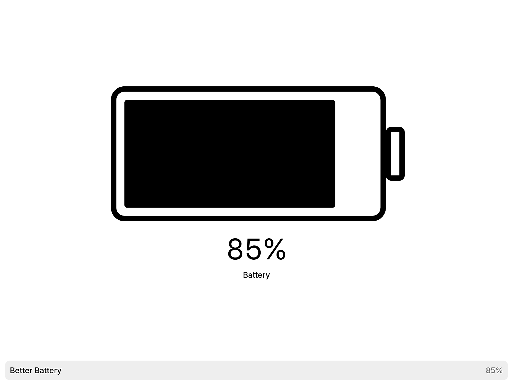
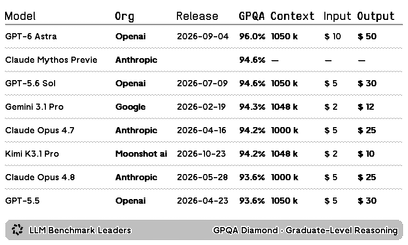
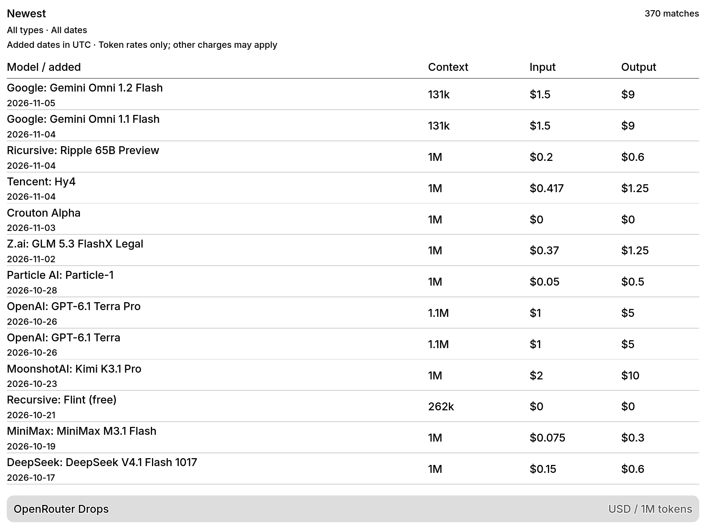

# TRMNL plugins

Community source for TRMNL plugins maintained by Charles Bine. Bug reports,
layout improvements, and pull requests are welcome.

| Plugin | Recipe | Source status | License |
| --- | --- | --- | --- |
| [Better Battery](better-battery/) | [Install](https://trmnl.com/recipes/217763) | Maintained revision of the published plugin | CC-BY-4.0 |
| [LLM Benchmark Leaders](llm-benchmark-leaders/) | [Install](https://trmnl.com/recipes/101445) | Published leaderboard with portability fixes | CC-BY-4.0 |
| [OpenRouter Drops](openrouter-drops/) | Not yet published as a recipe | New model listings, filtering and cost comparisons | MIT |

Each folder is a normal `trmnlp` project with `src/`, `.trmnlp.yml`, tests,
and its own README. Account-specific plugin IDs and credentials are omitted.
Source exports were retrieved on November 6, 2026. The maintained revisions
here can be ahead of the hosted recipes; each module documents that boundary.

## Screenshots

Screenshots show the maintained source. Better Battery uses a sample 85%
charge; model data was captured from public feeds on November 6, 2026.
Each module README also shows an alternate theme or setting.

### Better Battery



### LLM Benchmark Leaders



### OpenRouter Drops



## Development

Install [Docker](https://docs.docker.com/get-docker/) and optionally
[just](https://github.com/casey/just). The runtime, renderer, linter and browser
test engine come from the official `trmnl/trmnlp` image.
The `just` commands and CI pin the image digest used for validation. Set
`TRMNLP_IMAGE` to try another official release before updating that pin.

From the repository root:

```sh
just lint openrouter-drops
just test openrouter-drops
just build openrouter-drops
just serve openrouter-drops
```

The same commands work for the other module names in the table. Preview is at
http://localhost:4567. Builds appear in the module's ignored `_build/` folder.
Tests mock remote feeds and write a screenshot report to its ignored `report/`
folder. No TRMNL account or API key is required for linting or mocked tests.

Without `just`, run the official CLI directly:

```sh
cd openrouter-drops
docker run --rm -v "$PWD:/plugin" trmnl/trmnlp lint
docker run --rm -v "$PWD:/plugin" trmnl/trmnlp test --report report
docker run --rm -v "$PWD:/plugin" trmnl/trmnlp build --png
```

## Contributions and releases

See [CONTRIBUTING.md](CONTRIBUTING.md) for tests, screenshots and pull requests.
CI checks all three modules. It does not deploy or carry account credentials.
Merging a pull request does not change a hosted recipe; releases are imported
and verified separately by the maintainer.

For a new personal installation, upload a module's files as a private plugin
or authenticate with `trmnlp` and push your own copy. See TRMNL's
[local development guide](https://github.com/usetrmnl/trmnlp).

## Licenses and data

Repository tooling and OpenRouter Drops use the [MIT license](LICENSE).
Better Battery and LLM Benchmark Leaders retain their published CC-BY-4.0
license, provided in each module folder. Preserve author and license notices
when contributing or redistributing those modules.

API data, model names, benchmark results and third-party services remain the
property of their respective owners. Test fixtures retain only public factual
metadata; OpenRouter descriptions are original sample text written for tests.
