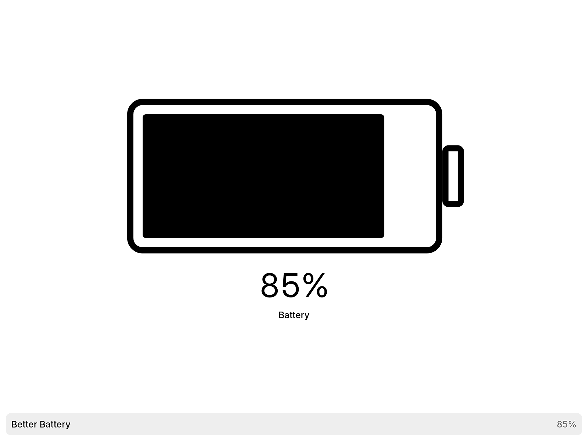
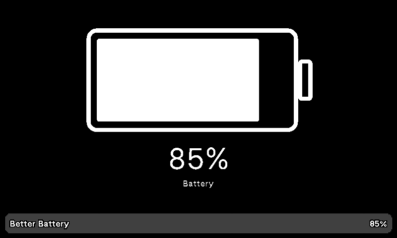

# Better Battery

Sample charge: 85%. X full screen; maintained revision.

OG dark mode

[Install the published recipe](https://trmnl.com/recipes/217763) ·
[Report an issue](https://github.com/metaember/trmnl-plugins/issues/new/choose)

A readable battery gauge using TRMNL's device charge percentage. No API key,
polling endpoint, or external data service is needed. The percentage option
controls the numeric reading; the gauge and status remain visible.

This is a maintained revision of Charles Bine's published recipe, exported on
November 6, 2026. It replaces fixed pixel geometry with a scalable SVG, uses
native Framework typography, and repairs the percentage toggle. The public
source can be ahead of the installed recipe. These source changes have not
been deployed to existing recipe users.

All four layouts are included. Unknown charge is shown as missing data rather
than zero; numeric values are rounded and constrained to 0–100. Under 15% is
labeled low battery, and 100% is labeled fully charged.

From the repository root, run `just lint better-battery`, `just test
better-battery`, and `just build better-battery`. Preview charge is a sample
value in `.trmnlp.yml`; installed instances use `trmnl.device.percent_charged`.

Copyright Charles Bine. Licensed under [CC-BY-4.0](LICENSE), retaining the
published recipe's attribution terms. See the root contribution guide.
