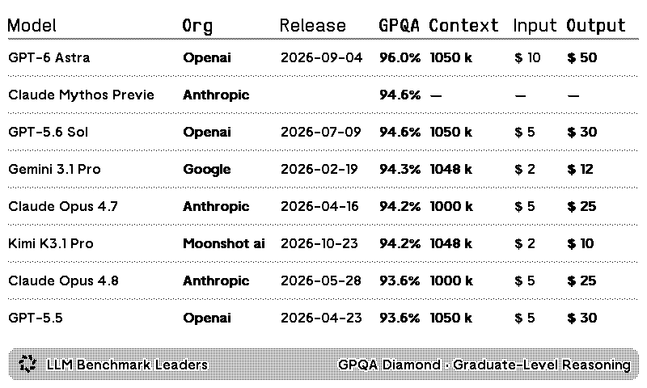
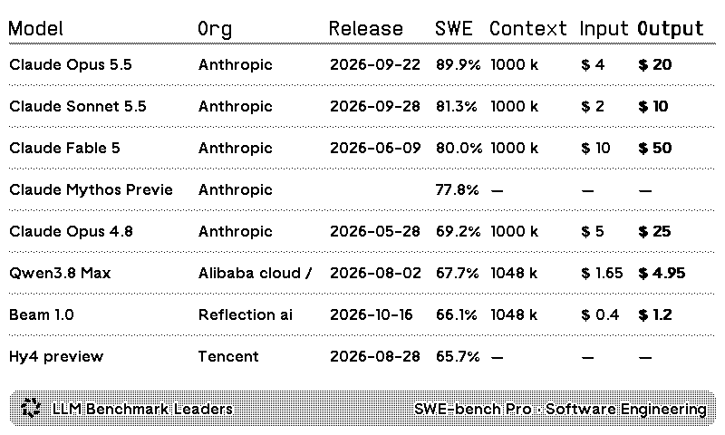

# LLM Benchmark Leaders

Public feed snapshot: November 6, 2026. OG full screen; maintained revision.

OG with SWE-bench Pro

[Install the published recipe](https://trmnl.com/recipes/101445) ·
[Report an issue](https://github.com/metaember/trmnl-plugins/issues/new/choose)

Compare models on one reported benchmark using the public
[ZeroEval feed](https://api.zeroeval.com/leaderboard/models/full?justCanonicals=true).
Choose a benchmark or rotate a capability-diverse group each UTC day. Prices
are source-reported USD per million input/output tokens. Scores are the
source's reported results, not an overall model recommendation.

This folder starts from the published leaderboard exported on November 6,
2026. It keeps that product rather than the separate experimental decision
brief. Portability fixes normalize select-option values, support the stock
serverless entry point, add missing compact title bars, and omit secondary
columns in narrow portrait layouts. These fixes have not been imported into
the hosted recipe yet.

From the repository root, run `just lint llm-benchmark-leaders`, `just test
llm-benchmark-leaders`, and `just build llm-benchmark-leaders`. Tests mock a
factual subset of the public feed; builds and previews poll the current feed.

Copyright Charles Bine. Licensed under [CC-BY-4.0](LICENSE), retaining the
published recipe's attribution terms. API data and benchmark names retain
their respective owners' rights.
