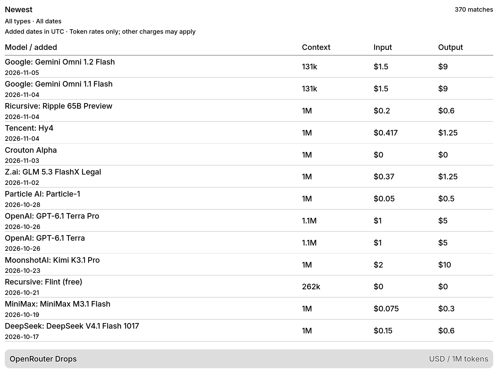
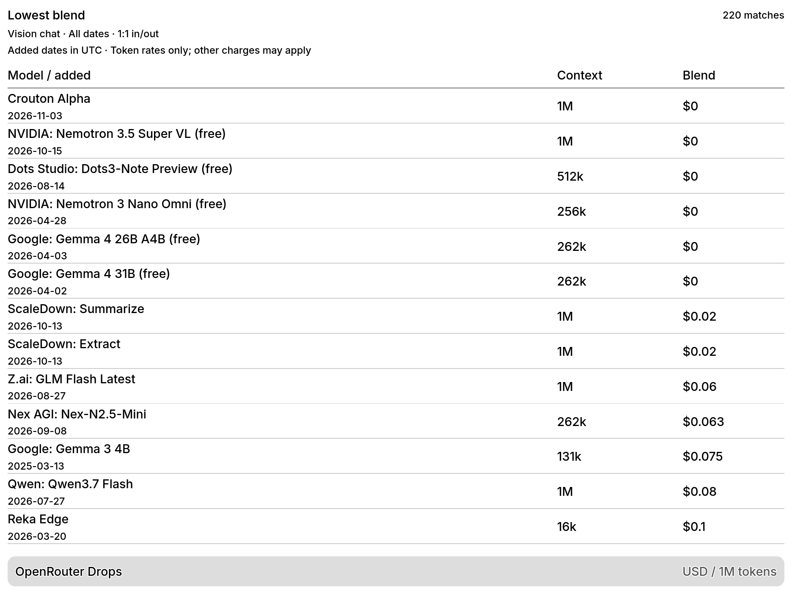

# OpenRouter Drops



Public feed snapshot: November 6, 2026. X full screen; maintained revision.

<details>
<summary>X vision chat by lowest blended cost, 1:1 mix</summary>



</details>

New OpenRouter model listings, optional modality and recency filters, and
weighted input/output token-cost comparisons. No API key or separate backend
is needed. This module is not yet a published TRMNL recipe.

[Report an issue](https://github.com/metaember/trmnl-plugins/issues/new/choose).
Licensed under the [MIT license](LICENSE). Public factual model metadata is
used in test fixtures; the description prose is original sample text for
rendering tests rather than vendor descriptions.

The full view is a top-aligned model table with catalog-added dates, context
windows and token prices. It supplies up to 16 ranked models; TRMNL's table
overflow engine fits the rows to each display. Cost mode shows the selected
blend instead of separate input/output columns. Half views show up to three
models, and the quadrant focuses on the first result. Layouts use TRMNL
Framework 3.0.3 without custom CSS.

## User options

| Setting | Options | Default |
| --- | --- | --- |
| Sort models by | Newest added; lowest blended token cost; largest context | Newest added |
| Model type | All; text only; vision chat; image generation; audio input/output; video generation | All |
| Added within | All dates; last 7, 30, or 90 UTC calendar days | All dates |
| Blended cost input/output mix | 75%/25% (3:1); 50%/50% (1:1); 90%/10% (9:1) | 3:1 |

Model types use the catalog's modality arrays. Text-only models accept and
produce only text. Vision chat accepts images and produces only text. Image
and video generation require that output modality; audio matches either input
or output. Filters can overlap. Unknown modalities only match All.

Filtering applies to the whole catalog before selecting the visible results.
Newest uses date descending, cost uses blended rate ascending, and context
uses valid context length descending, with missing context last. Ties use the
newer added date, then model ID. Filter combinations with no results explain
how to broaden the selection.

Blended cost is the weighted price for one million combined input/output tokens:
`(input_ratio × input_price + output_price) / (input_ratio + 1)`. For the default
3:1 mix, 750,000 input tokens and 250,000 output tokens make up that million.
Each source price is already expressed per million of its own token type.
This is an estimate based on the selected mix, not measured usage.

## Data semantics

- Dates are the catalog's `created` timestamps, shown in UTC. They describe
  additions to OpenRouter, not necessarily a model's original release date.
- Routing aliases under `openrouter/`, invalid dates, and future dates are
  excluded. In newest and context modes, pricing variants such as `:free` or
  `:batch` are hidden when their base model is present; standalone variants
  remain visible. Cost mode considers variants and retains the cheapest
  matching listing per base model, including genuinely zero token rates.
- Cost sorting requires text-only output and valid rates for both input and
  output. Models producing image, audio, or video are not compared by blend;
  their other billing units cannot be inferred from token rates. Selecting a
  media-output type with cost sorting can therefore yield no comparable models.
- Prices are the catalog's prompt/completion token rates converted to USD per
  million tokens. They are not a quote for every provider, context tier, or
  modality. Image, video, audio, search, and other charges can apply separately.
  Zero remains `$0`; missing, negative, or invalid rates show `Not listed`.
- Context windows use rounded decimal `k` and `M` token counts. Missing or
  invalid context stays `Not listed`.
- Empty data and unexpected response shapes have explicit screens. Hosted
  polling failures may retain TRMNL's previous successful render; the displayed
  added date is not a freshness or last-success indicator.

## Development and validation

Run from the parent workspace:

```sh
just lint openrouter-drops
just test openrouter-drops
just build openrouter-drops
just serve openrouter-drops 4569
```

The browser suite checks full, half-horizontal, half-vertical, and quadrant
views on OG 1-bit, OG 2-bit, and X 4-bit in landscape and portrait. OG is
800×480 and X is 1872×1404; portrait swaps the dimensions, and mashups use the
framework's corresponding slots. Tests use TRMNL's current device definitions
and enforce their PNG delivery limits.

`tests/density_spec.rb` verifies that the full view uses the available height
and shows at least ten models on X when enough models match.
`tests/display_spec.rb` runs eight representative settings combinations across
every view and display, including all model types, the three sorts, cost mixes,
date windows, and incompatible filters. It also checks filtered dark-mode
content and API failures in every slot. `tests/boundary_spec.rb` exercises long
names/descriptions, a single result, and missing prices/context on OG 1-bit and
X in both orientations. The baseline recipe suite tests every dropdown option
independently; this is not an exhaustive Cartesian product of all settings.

The display assertions check browser errors, leaked Liquid/data values,
overflow and clipped glyphs, overlapping text, unnecessary truncation, visible
layout/title bars, complete price units in narrow slots, and image size. Tests use the local renderer's real browser
and device-quantized screenshots. Physical panel readability and delivery are
not covered by local browser tests.

Unit tests cover ordering, weighted costs, variant selection, modality filters,
and UTC recency boundaries. `tests/fixtures/models.json`
contains 20 recent listings plus image/audio-output examples captured from the
public catalog on November 6, 2026, retaining factual fields used by the transform
and replacing vendor descriptions with original sample prose.
Tests mock the API; builds poll the live catalog.
Generated previews and test reports are ignored under `_build/` and `report/`.

See the [repository guide](../README.md) for the Docker workflow. Deployment
and recipe submission are separate maintainer actions; CI only validates.
