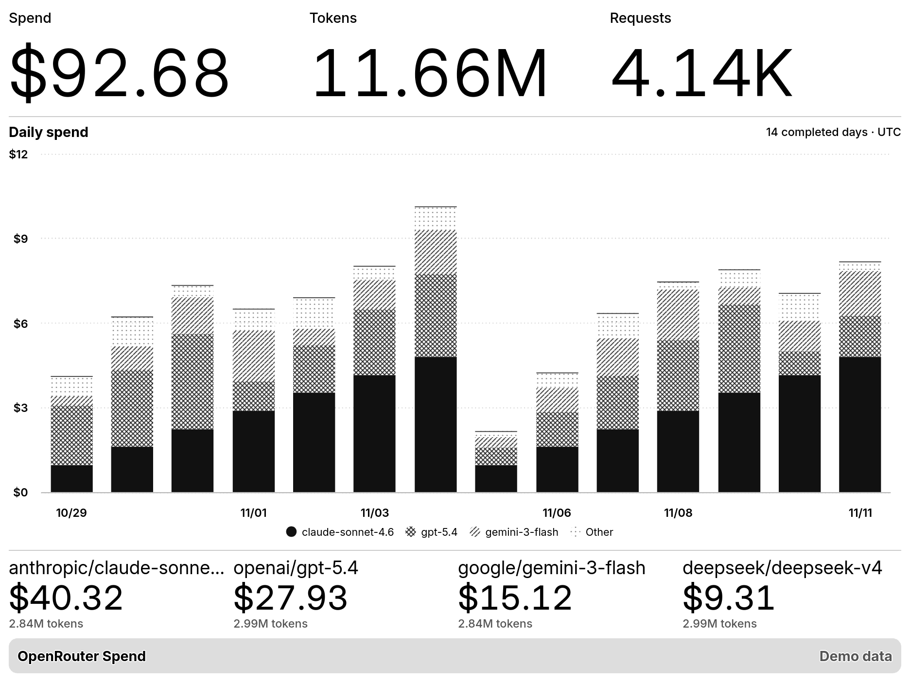
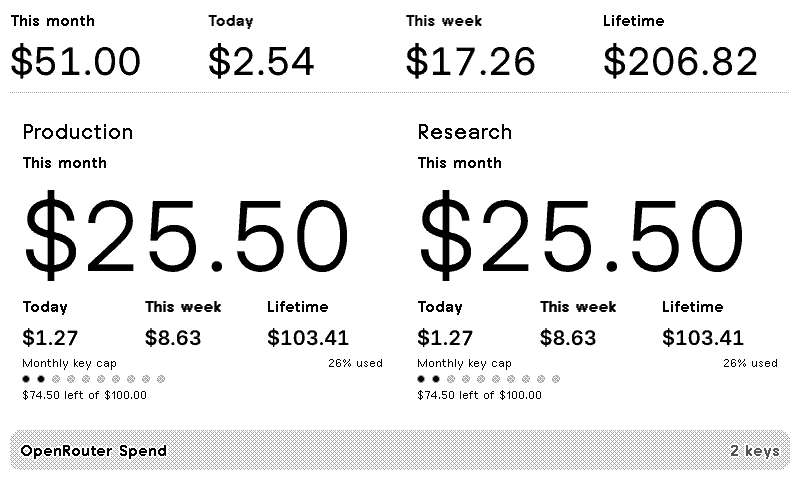

# OpenRouter Spend

A TRMNL dashboard for OpenRouter spend, tokens, requests, and API key budgets.
It refreshes hourly by default.





[Report an issue](https://github.com/metaember/trmnl-plugins/issues)

## Install

1. Build the import ZIP using the command below. In TRMNL, choose
   **Private Plugins → Import new** and select `_build/openrouter-spend.zip`.
2. For current spend and budgets, enter a regular OpenRouter API key. To track
   more keys, enter a comma-separated list in **Additional API keys**. Use
   `Label=key` to give any regular key a display name. The plugin accepts up to
   six unique keys.
3. For model, token, and historical data, enter an
   [OpenRouter Management key](https://openrouter.ai/settings/management-keys)
   in the **OpenRouter Management Key** field. This key is available on
   [Standard Pay-as-you-go and higher plans](https://openrouter.ai/pricing).
   When filled, this field takes
   precedence over regular keys. TRMNL runs the plugin and stores the credentials
   you enter in its password fields. The transform uses them for GET requests
   to OpenRouter.

To preview with sample data, enter `demo` in **OpenRouter API Key** and leave
**Additional API keys** and **OpenRouter Management Key** empty. Each preset
works in demo mode, and the screen is labeled **Demo data**.

## Presets

| Preset | What you see |
| --- | --- |
| **Overview** | With regular keys, see today's, this week's, this month's, and lifetime spend. With a Management key, see spend, tokens, requests, and a daily trend. |
| **Models** | Daily stacked spend by model and a ranked list with spend and token counts. |
| **Keys** | With regular keys, compare spend across periods and remaining budgets. In a two-key comparison, budget dots mark each 10% used alongside the exact percentage. Three to six keys appear in a table. With a Management key, see daily history broken down by key. |
| **Tokens** | Daily input and output token stacks plus total, input, output, and reasoning token counts. |

**History window** selects 7, 14, or 30 completed UTC days. **Time grouping**
shows a point per day or groups totals into Monday-start UTC weeks. Weekly
points are labeled by their first included date. Weeks at the edges can be
partial because the selected window controls which days are included. **Chart metric**
switches the time series and rankings between spend, tokens, and requests.
**Chart style** switches between trend lines and stacked columns. The default
uses lines for a single series and stacks for comparisons. Model and key charts
show the top three series and combine the remainder into **Other**. Full and
half views include charts. The quadrant shows the headline totals.

With a Management key, Overview, Models, and Tokens use account activity by
default. Keys defaults to up to six keys in the default workspace, ranked by
current monthly spend. To scope any preset, enter up to six exact key names or
hashes in **Track specific managed keys**. Duplicate names can be disambiguated
with hashes from the [keys API](https://openrouter.ai/docs/api/api-reference/api-keys/list-api-keys).

Spend uses OpenRouter's `usage` field without adding its separate BYOK inference
estimate. Total tokens are input plus output. Reasoning tokens are displayed
separately. History comes from the
[activity API](https://openrouter.ai/docs/api/api-reference/analytics/get-user-activity),
which omits the current UTC day.

## Develop locally

From the collection root, run the same checks as CI:

```sh
just lint openrouter-spend
just test openrouter-spend
just build openrouter-spend
```

The browser report is in `report/index.html` inside this module. To use live
credentials in a local preview, set `OPENROUTER_API_KEY`,
`OPENROUTER_EXTRA_KEYS`, or `OPENROUTER_MANAGEMENT_KEY` in an ignored
`.env.local` and pass it to Docker with `--env-file`.

To create the import archive, run from this module's folder:

```sh
mkdir -p _build
(cd src && zip ../_build/openrouter-spend.zip settings.yml *.liquid transform.js)
```

## Submit a public TRMNL recipe

1. Import the ZIP into a new private plugin. Enter `demo` in **OpenRouter API Key**
   and pick **Models** for the featured screen. Leave the other key fields empty.
2. Refresh the plugin and verify its rendered screen says **Demo data**. Use that
   screen as the recipe preview. The import already includes the public recipe
   description and GitHub support links.
3. Open the publish dialog, run **Ask trmy**, and submit as **Public** once
   TRMNL's checks are clear. TRMNL reviews public submissions before listing them.

Keep the recipe master in demo mode. Use a separate installation with your
own keys. See [TRMNL's publishing guide](https://help.trmnl.com/en/articles/10122094-plugin-recipes)
and [demo data guidance](https://help.trmnl.com/en/articles/12772238-demo-data-for-publishing-plugins).
