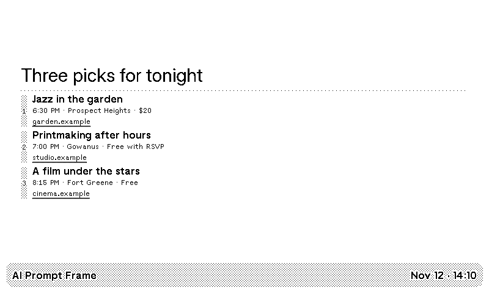
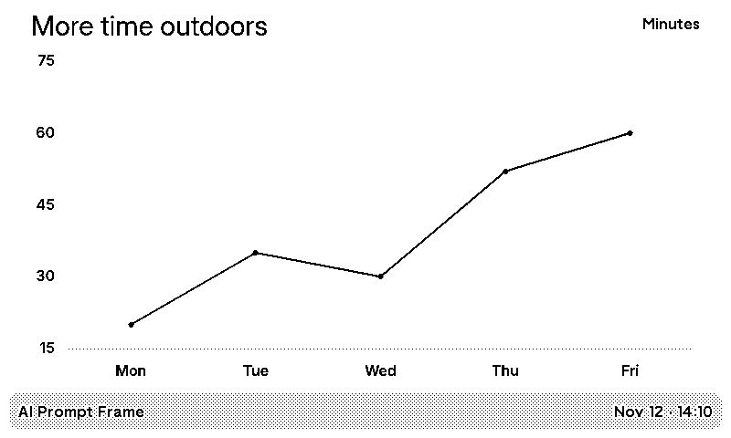
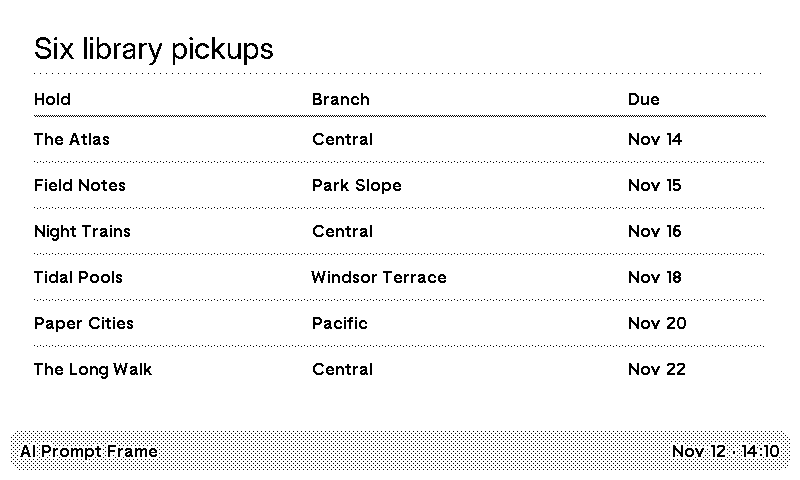
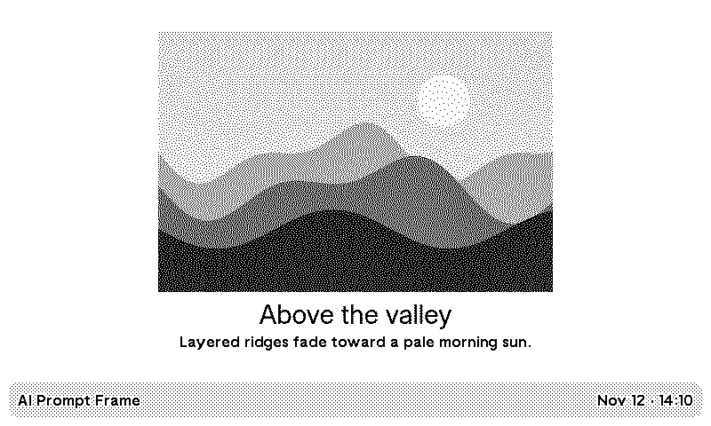

# AI Prompt Frame

A TRMNL recipe that turns a recurring prompt into a card for your display.
OpenRouter bills generations and any search or fetch calls to your key.
The recipe sends requests directly to OpenRouter from TRMNL polling.
The first screen is a key-free demo from a fictional lunar outpost. It rotates
daily (UTC) between a solar power chart, crew schedule, and shift brief. Enter
your own key to replace the demo with live results.

## Example screens

These are TRMNL OG renders with sample data. Paste the inputs into **Prompt**
and **Prompt context**, or use **Daily Brief** with a city and web search.

| Daily Brief | Line chart |
| --- | --- |
|  |  |
| “Find three things to do in {{city}} tonight. Include a time, price, and source.” | “Plot my minutes outdoors this week.” Add the daily values in **Prompt context**. |
| **Table** | **Image card** |
|  |  |
| “Turn these library holds into a table with title, branch, and due date.” Add the holds in **Prompt context**. | “Caption this view from the ridge at dawn.” Set **Image URL** to a public photo and add any details to include. |

## Set up

1. Enter an OpenRouter API key.
2. Pick **Daily Brief** and enter a city for a list of upcoming local events,
   or pick **Custom** and write a prompt. You can also override the Daily
   Brief prompt.
3. Leave **Layout** on **Auto** to let the model choose, or select a layout.
4. Set **Max refresh rate** in TRMNL. The recipe starts with a daily interval.
   The actual refresh time follows device and playlist activity.

In prompts, `{{date}}`, `{{time}}`, and `{{timezone}}` use your TRMNL account
timezone. `{{city}}` uses the city you enter. The city field is optional if
your prompt has no location variable. `{{context}}` inserts the notes or
data you enter in **Prompt context**. Try this in the Prompt field.

> Find up to three independent cinema screenings in {{city}} on {{date}}
> starting after {{time}}. Prefer the theater's own calendar. Include start
> time and price when listed.

Daily Brief enables web search and page fetch by default. Custom starts with
them off. You can override either setting. The default model is
`openai/gpt-6-luna`. An alternative must support structured output, and tool
calling when web access is on.

Search results show the source domain on the display and link to the exact
page in the web preview. A pick needs a matching provider citation to appear
when web access is on. This checks that the URL came from the provider's
response metadata. Check the source for details before making plans.

A failed refresh keeps the last successful result and marks its original
timestamp **Previous**.

## Layouts

| Layout | What it shows |
| --- | --- |
| Short answer | A headline and a compact explanation |
| Ranked list | Up to three picks on full and vertical half, two on horizontal half, and one in a quadrant |
| Big number | A prominent value and unit with a short explanation |
| Quote | A short quotation with attribution when available |
| Comparison | Two alternatives with parallel details, kept together even in a quadrant |
| Bulleted list | Up to five unordered points, with up to three in short slots |
| Timeline | Up to four dated milestones in chronological order, with the first two in short slots |
| Long-form text | Up to three short paragraphs on full screen, two in a vertical half, and the lead in short slots |
| Table | Two or three columns, with up to six rows and a row count when a short slot shows only three |
| Bar chart | Horizontal bars for two to eight categories, with a zero baseline, a unit label, and up to five categories in short slots |
| Line chart | Two to eight ordered points to show change over time |
| Area chart | Two to eight ordered points for a nonnegative trend with shading under the line |
| Image card | A large, dithered image above a centered title and caption, with a center crop in short slots |

For an image card, set **Image URL** to a public HTTPS link directly to a
PNG, JPEG, or WebP. Describe the image in your prompt or in **Prompt context**
if you want a caption. The model writes the text, and the renderer displays
the supplied image. Auto can select Image card when the URL is set. Image
generation would require an async job and a place to serve the generated
asset to TRMNL.

For charts and tables, provide numbers or rows in `{{context}}`, or enable
web access for sourced data. The model selects and formats the values.
The recipe validates the shape, keeps numeric points in order, and requires a
provider citation for web-backed charts and tables. The renderer draws the
validated data using Highcharts or a native table. Charts fill the available
height after the heading, labels, and title bar are laid out.

The presets are Daily Brief and Custom. Supply any domain-specific data as
prompt context.

## Local development

Run these checks from the public modules repository.

```sh
just lint prompt-frame
just test prompt-frame
just build prompt-frame
```

Run this from the plugin directory to exercise the Liquid request, transform
and Firefox renderer with mocked responses.

```sh
docker run --rm -v "$PWD:/plugin" trmnl/trmnlp test --report report
node --test tests/transform_test.js
```

Open `report/index.html` for fixture previews of all layouts in all four
OG screen slots and selected TRMNL X cases. A regular build without a
key shows the rotating demo. For a live local preview, set `OPENROUTER_API_KEY`
in the ignored `.env.local` file and run `just serve prompt-frame` from the
parent. To override the prompt in `.trmnlp.yml`, wrap it in
`…` so the preview tool leaves placeholder braces intact.
In the hosted recipe, enter placeholders directly in the Prompt field.

Before publishing, install a private copy and trigger a live refresh for
Custom and Daily Brief. Check that a sourced brief arrives and that the next
refresh updates its timestamp. TRMNL direct polling waits 10 seconds per
attempt. If live research consistently exceeds that limit, it needs a callback
service to wait for the model and validate its response. TRMNL Async Polling
skips the plugin transform.

This module uses the repository's [MIT license](../LICENSE).

- [TRMNL plugin strategies](https://help.trmnl.com/en/articles/17434705-plugin-strategies)
- [TRMNL refresh rates](https://help.trmnl.com/en/articles/10113695-how-refresh-rates-work)
- [OpenRouter web tools](https://openrouter.ai/blog/agentic-web-tools/)
