# Space Terminal

A fictional spaceport on TRMNL e-paper. Check your gate, scan a moon, or tune
into a distress beacon. Pick one of seven screens in the Private Plugin
settings, or choose **Daily Rotation** to cycle through them by UTC date.

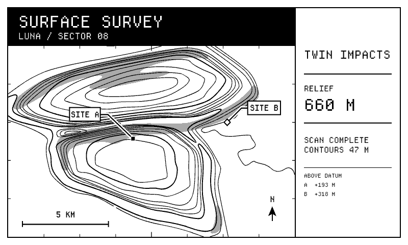

**Surface Survey.** Explore twelve landform families across Europa, Luna, Mars,
and Titan. Contours show elevation, and shaded slopes and site markers help
read the terrain.

## The other six screens

| | |
| --- | --- |
| 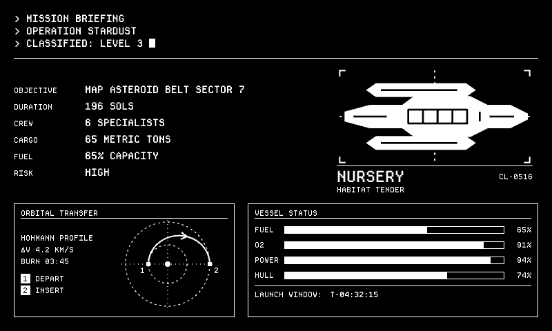 | 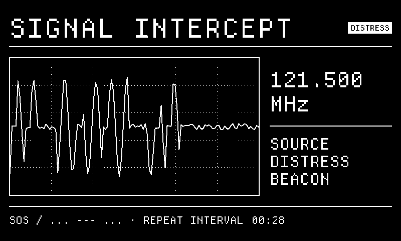 |
| **Mission Brief.** Twelve ship silhouettes cycle through seeded missions with changing fuel, oxygen, power, and hull readings. | **Signal Intercept.** Six procedural waveforms include chirps, pulse trains, quiet scans, and an SOS distress beacon. |
| 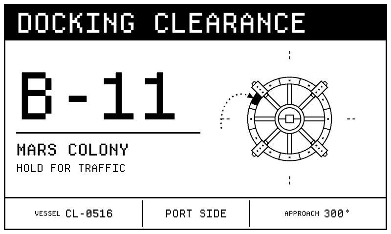 | 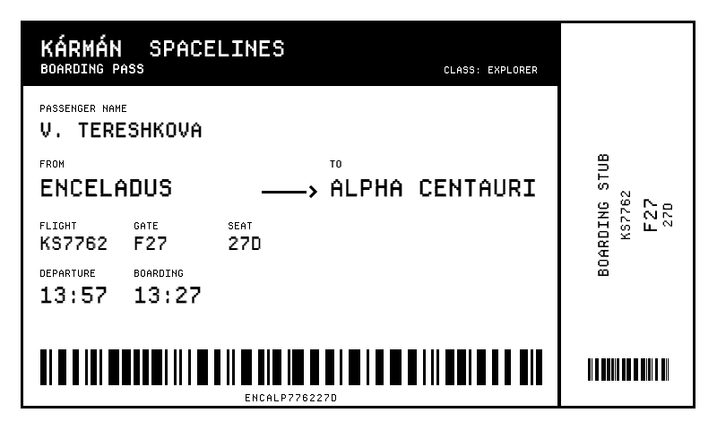 |
| **Docking Clearance.** Get a berth and approach bearing for the day's ship. The station diagram highlights the assigned sector. | **Boarding Pass.** The day's passenger, route, gate, seat, and decorative barcode come from the date seed. Boarding starts 30 minutes before departure. |
| 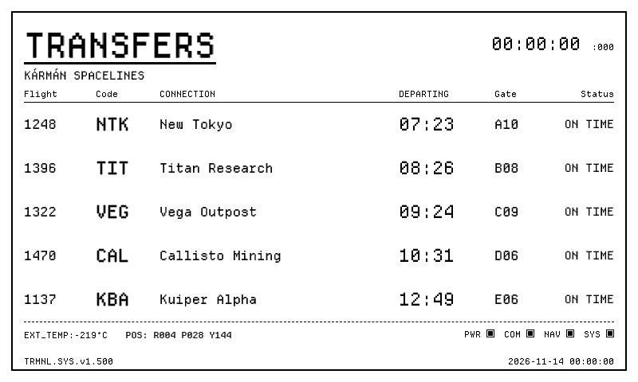 | 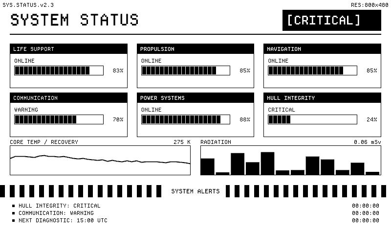 |
| **Departure Board.** Switches among departures, arrivals, and transfers, each with its own status vocabulary. | **System Status.** Six subsystem meters, three operating states, and six temperature trends. |

## Full screen and mashups

The seven presets support full screen, horizontal half, vertical half, and
quadrant. Wide slots set readouts beside diagrams. Tall slots stack them.
The narrowest signal layouts split the waveform into two successive views, and
tall survey layouts rotate the contour map to keep the sites in view. The map
fills its panel in every slot.

| TRMNL X full screen, portrait | TRMNL X quadrant, landscape |
| --- | --- |
| 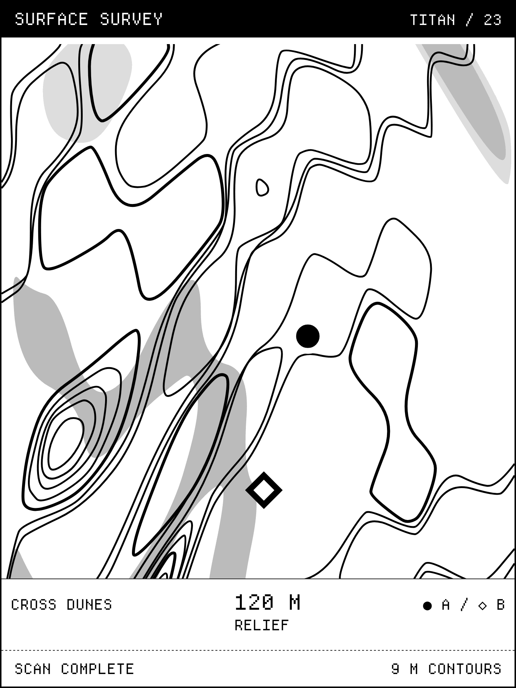 | 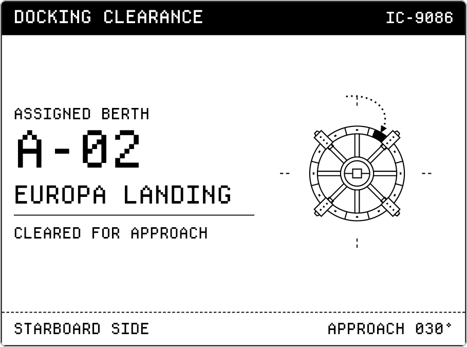 |
| **Horizontal half, landscape** | **Vertical half, landscape** |
| 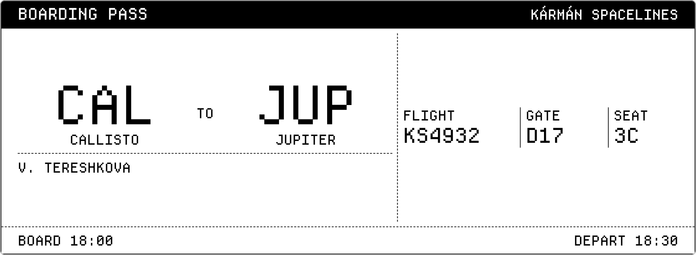 | 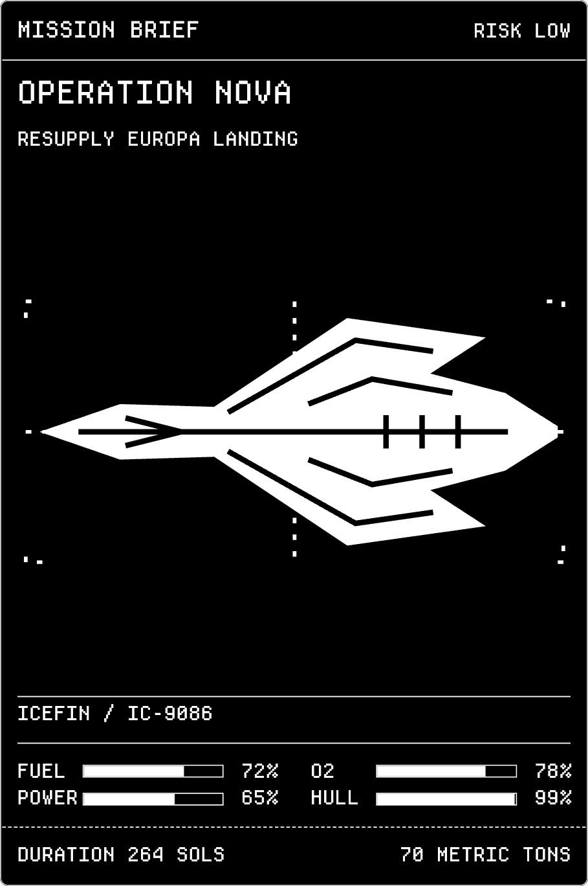 |

These are local renders. The first seven previews are 800 × 480. The full-screen X landscape layout fits the original 5:3 artwork
inside the panel. Survey maps use black stippling for shaded slopes on 1-bit
displays and up to two gray relief tones on displays that support them. The
daily seed varies the orientation, size, and shape of the terrain within each
landform family. Contour spacing follows the total elevation range.

## How it works

1. A [Node.js transform](serverless.mjs) runs inside TRMNL and generates
   the selected screen. The UTC date seeds the artwork and readings, so they
   stay consistent throughout the day. Telemetry timestamps track the refresh.
2. TRMNL merges the JSON into [Liquid templates](src/full.liquid). Shared CSS
   handles layout and Departure Mono typography. SVG draws the diagrams from
   the feed's geometry. [The terrain generator](terrain.mjs) uses marching
   squares to trace contour lines through a seeded heightfield.
3. TRMNL renders the composed screen to a bitmap and delivers it to the device.

The layouts use [Departure Mono](https://github.com/rektdeckard/departure-mono)
by Helena Zhang, distributed under the SIL Open Font License.

## Hosted setup

1. From the plugin directory, package the layouts, settings and Node bundle.

   ```sh
   mkdir -p _build
   (cd src && zip ../_build/space-terminal.zip settings.yml *.liquid transform.js)
   ```

2. In TRMNL, choose **Private Plugins → Import new** and select the ZIP.
   [TRMNL import instructions](https://help.trmnl.com/en/articles/10542599-importing-and-exporting-private-plugins)
3. Choose a **Screen** or **Daily Rotation** in the plugin settings. The
   default is Boarding Pass. TRMNL uses a 60-minute refresh interval. You can
   add the [plugin icon](docs/icon.png) from the settings page.

The Static strategy and Serverless Node runtime generate the data on TRMNL.
Setup requires no API key or separate JSON server.

## Local development

From the parent `trmnl-plugins` workspace, run:

```sh
node --test space-terminal/tests/generator_test.js
just lint space-terminal
just build space-terminal
```

After editing the generator, rebuild the single file used by TRMNL from the
plugin directory. Keep it with the source so the CLI and CI can test it directly.

```sh
npx --yes esbuild@0.28.2 serverless.mjs --bundle --platform=node --target=node20 \
  --format=iife --global-name=spaceTerminal \
  '--footer:js=function run(input) { return spaceTerminal.run(input); }' \
  --outfile=src/transform.js
```

Build output goes to `space-terminal/_build/`.
For a different resolution, pass dimensions to the renderer:

```sh
./bin/plugin space-terminal build --png --width 1872 --height 1404
```

Run `just preflight space-terminal --checks-only` to render the checked-in
[test scenarios](.preflight.json) in the workspace device matrix. Each fixes the
clock and selects a preset so it exercises the shipped transform. The command prints
the path to its HTML report. Use `just preflight space-terminal` for the full
source and screenshot review.

The module is available under the [MIT license](LICENSE).
