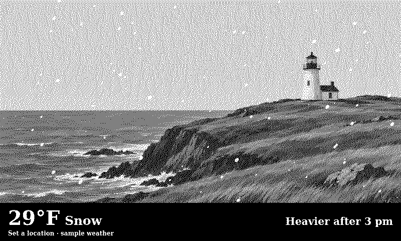

# Weather Window

Look out over a lighthouse, an alpine lake, or a cyberpunk night market.
Pick the scene, window frame, and forecast footer independently. Rain, snow,
fog, and moonlight follow the forecast.



## Install on TRMNL

1. Import the flat files in `src/` as a [TRMNL Private Plugin](https://help.trmnl.com/en/articles/10542599-importing-and-exporting-private-plugins).
2. Pick a **Location** for the live forecast. The plugin opens with a snowy
   lighthouse and sample weather until you set a location.
3. Choose a collection and landscape, or select **Custom image** to use a
   public HTTPS image. **Custom gallery** accepts a public GitHub URL for a
   [version 1 gallery manifest](assets/scenes/manifest.json).

TRMNL sends the location coordinates to Open-Meteo and runs the bundled Node
transform on the returned forecast. The transform selects scenery, formats the
forecast, and prepares the weather overlay. The built-in artwork uses static
GitHub URLs, with a bundled lighthouse for the default and image fallback.
The full scene library requires the artwork files to be present at those URLs.

Defaults are a frameless window, Charcoal sill, the Now + outlook footer,
Fahrenheit, and mph. With a location set, the default scene choice rotates
within Quiet views. Random choices stay stable for six hours. The weekly
footer shows seven days in wide layouts and fewer in smaller ones.

Forecast data from [Open-Meteo](https://open-meteo.com/), licensed under
[CC BY 4.0](https://creativecommons.org/licenses/by/4.0/). Weather Window
formats the forecast and maps conditions to illustrated effects. The free
forecast endpoint is for noncommercial use. A commercial release needs an
endpoint licensed for that use. See [Open-Meteo's terms](https://open-meteo.com/en/terms).

## Optional Scene Studio and contributions

Run `npm ci` and `npm run studio` for the browser preview and scene gallery.
Use the optional BYOK panel to try a prompt and download a generated raster
background. It is a separate convenience tool for making your own art.
The browser session uses its own key and settings. Upload a finished background
to a supported HTTPS host and select **Custom image** in the TRMNL plugin
to use it on your device. Enable **Custom image already shows weather** if the
artwork includes rain, snow, or other weather effects.

For a shared gallery, add a WebP and a version 1 manifest entry in
`assets/scenes/`. Append new entries for newer-weighted random selection.
Use `focus` (top, center or bottom), `skyX` (0–1 or null), and `nightLit`
where appropriate. Add a matching Landscape option in `src/settings.yml`
for direct selection.

The optional CLI can create new artwork in the same style. It takes an
`OPENAI_API_KEY` from your environment. Use `--prompt-only` to print the prompt
without making a provider request.

```sh
npm run scene:generate -- orchard "Orchard hillside" "Rows of fruit trees on a slope" --prompt-only
```

## Local validation

Use Node 22 or later. Run `npm ci`, `npm run build`, and `npm test`. The build
refreshes the overlay, embedded lighthouse, and Node transform in `src/`.
Run `npm run build:studio` for the optional browser tools. The `npm start`
feed is available for local development of the earlier server-backed prototype.

From the workspace root, run `just lint weather-window`, `just build
weather-window`, and `just preflight weather-window --checks-only`. Preflight
uses forecast fixtures and checks the default preview, live forecast formatting,
and the sample fallback. Hosted polling and physical displays require separate
verification.
